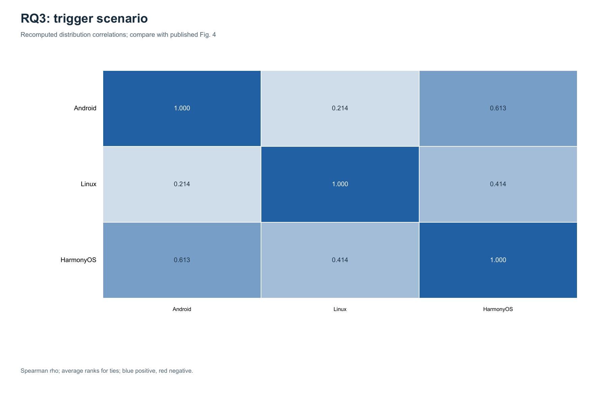

# OS Defects Replication: RQ1 / RQ2 / RQ3

**提交人：1230036051 GUO HAOXUAN** · 检查日期：2026-11-06；2026-11-07 增补 Figures 2/3 分箱约定敏感性分析

**2026-11-14 更新与汇报：1230037310 钟峻瀚**。保留仓库现有提交人信息；本轮由 Codex 协助分析、实现和制作材料，实际人工核验与共同署名由成员据实确认。

复现 [*Toward Understanding Operating System Defects*（arXiv:2608.20643v1）](https://arxiv.org/html/2608.20643v1) 的核心统计，使用作者公开的 1,500 条标签，Android、Linux、HarmonyOS 各 500 条。当前提供三个 RQ 的可运行代码、逐项对比、17 张核心图与 11 张敏感性分析图、实际运行记录、中文报告和 10 页可编辑答辩 PPT。

## 助教检查入口

- [最新进展：2026-11-14 类别集合敏感性、补丁正文审计与答辩材料](docs/weekly/2026-11-14.md)
- [10 页答辩 PPT](presentations/defense_2026-11-14_v2.pptx)、[逐页讲稿](presentations/speaker_notes.md)
- [相关系数差异的候选解释：成对排除共同零类别](docs/category_policy_analysis.md)
- [12 条补丁正文审计：8 条真实 diff、4 条登录页](docs/review_evidence_audit.md)
- [A/B 独立待填表及说明](review_materials/blind/README.md)、[当前人工核验状态](results/human_review/status.json)
- [2026-11-13 周五检查：Figure 4 缺口补齐分析与抽查材料](docs/weekly/2026-11-13.md)
- [2026-11-12 同步核验、文档修正与下一步安排](docs/weekly/2026-11-12.md)
- [完整复现报告：方法、结果、差异、局限与贡献](docs/reproduction_report.md)
- [运行汇总](results/full/stage_summary.json)、[实际环境与源文件摘要](results/full/environment.json)、[输入来源](results/full/source_provenance.json)
- [验证记录：109 项测试、全新下载、离线缓存、各 RQ、类别集合与审核表入口](results/full/verification.json)
- [三次运行统计](results/full/tables/repeated_run_statistics.csv)、[17 张图清单](results/full/figure_manifest.json)
- [方法附录：修复规模口径敏感性、Figure 4 缺口补齐分析与 Overall 待确认问题](docs/methods_appendix.md)
- [新增：Figures 2/3 分箱约定敏感性分析（逐柱对比与汇总）](results/repair_size/tables/convention_comparison.csv)
- [新增：Figure 4(c)/(d) 缺口补齐分析与修复规模异常证据清单](results/gap_analysis/tables/gap_analysis_summary.json)
- [前一阶段 RQ1 周报](docs/weekly/2026-11-06.md)、[提交人信息](SUBMISSION.json)

## 核心结果

| 研究问题 | 论文对象 | 比较数 | 吻合 | 不吻合 | 未确认 | 明细 |
|---|---|---:|---:|---:|---:|---|
| RQ1：五维分类分布 | Table II | 114 | 114 | 0 | 0 | [CSV](results/full/tables/table_ii.csv) |
| RQ2：三组联合分布 | Tables III–V | 438 | 438 | 0 | 0 | [CSV](results/full/tables/joint_comparison.csv) |
| RQ3：跨系统相关性 | Figure 4(a–c) | 9 | 8 | 1 | 0 | [CSV](results/full/tables/similarity_comparison.csv) |
| **合计** | **552 个表格值 + 9 个独立系数** | **561** | **560** | **1** | **0** | |

CSV 保留论文值、计算值、差值、`match` / `mismatch` / `unconfirmed` 状态和具体出处。吻合按论文两位小数比较；表格最大绝对差为 0.00 个百分点，相关系数另保留完整精度。

**唯一核心差异：** Android–HarmonyOS 的触发场景 Spearman 相关系数重算为 **0.6126374746329801**，而[论文 Figure 4(c)](https://arxiv.org/html/2608.20643v1/heatmap-c.png)为 **0.38**。输入向量、并列平均秩和结果均保存在[相似度汇总](results/full/tables/similarity_summary.json)，没有改动算法来追求吻合。差异原因仍需作者的实际计算输入或脚本确认。

**本轮找到相容的候选解释：**对每一系统对排除双方计数都为零的类别后，这一系数变为 **0.3768511731740915 → 0.38**；同一规则使全部九对均按论文显示精度吻合。唯一被排除的是 Android–HarmonyOS 的 `Mul/Loc Dep`（0/0；Linux 为 1）。这是差异出现后开展的探索性分析，尚不能证明作者采用了该规则；原固定全类别核心结果仍保留 **8/9**。详见[完整输入、平均秩、27 项比较及 SciPy 核验](docs/category_policy_analysis.md)。



RQ1 前四维单标签比例合计 100%；代码元素为多标签，每类均除以 500，不要求比例之和为 100%。RQ2 每格也是“该格数量 / 500”，九张联合表均总数 500，双边际与独立单维计数一致。RQ3 使用相同类别顺序对齐计数向量，再计算平均秩的 Pearson 相关，即标准 Spearman。

## 新增分析：Figures 2/3 分箱约定敏感性

论文 Figure 2/3 每根柱子都印有精确百分比，但未说明边界归属、177 条零函数记录怎么放、7 条 `10+`/`20+`/`30+` 删失记录怎么归箱。柱标签已事先转写为独立基准（[figure_baselines.json](reference/figure_baselines.json)）；`scripts/run_repair_size.py` 读取该基准，对每种显式约定重算并逐柱对比（102 项，标注为本项目新增分析，**不计入** 561 项核心对比）：

**在已测试候选中，左闭右开口径（末箱含最终上界）配合零值计入首箱、删失记录按下界归箱，得到三个序列共 39/39 吻合。** 这是与图表相容的处理，尚不能证明作者采用了该脚本或精确取值。HarmonyOS `10-50` 箱 14 条中有 7 条删失；将它们改为未归属只改变 1/12 个函数数柱值。论文正文把 Figure 3 集中区间描述为 1–3，但该口径重算为 73.6% / 52.6% / 80.6%，与柱标签 67.0% / 75.8% / 74.4% 全部不符。已测试的右闭合实现也不能匹配：例如 Android 修改行数 `0-10` 箱论文为 34.0%，右闭合重算为 37.2%。详见[方法附录](docs/methods_appendix.md)。

```powershell
# 复算敏感性分析（三次运行语义摘要一致；--no-plots 可跳过绘图）。
py -3.11 scripts/run_repair_size.py
```

输出到 `results/repair_size/`：逐柱对比 `tables/convention_comparison.csv`（含逐行论文出处）、各约定吻合汇总 `tables/config_match_summary.csv`、机器可读结果 `tables/repair_size_sensitivity.json`、数据校验与环境记录 `data_validation.json` / `environment.json`，以及 11 张对比图（8 张单约定重算图 + 3 张“论文基准 vs 两种约定”对比图）。

## 新增分析：Figure 4 差异与修复规模证据补齐

**以下全部是本项目新增的探索性分析，不是经验证的论文复现，不计入 561 项核心对比，也不改变任何作者原值。**

```powershell
py -3.11 scripts/run_gap_analysis.py
```

- **Figure 4(c)**：原有 **144 个口径**仅比较完整类别与“三系统全为零才排除”的类别集，Android–HarmonyOS 触发场景所得值与 0.38 的最小差为 0.2326。它们**未覆盖成对排除共同零类别**，不能据此排除所有常见口径。本轮补做三种类别规则的 27 项比较，成对排除规则为 9/9 吻合；作者实际方法仍待确认。
- **Figure 4(d)**：把未定义的 Overall 输入显式枚举为 **42 个候选**（6 种拼接向量 × 2 系数 + 2 种逐维聚合），与原图 `-0.11 / 0.05 / -0.04` 相比最好的三对平均绝对差仍有 **0.0930**。**没有任何候选能复现**，逐行状态保持 `unconfirmed_candidate`，需作者确认输入向量、拼接方式、权重与系统对标注。
- **Figures 2/3 证据**：已有 177 条零函数 + 7 条删失记录共 **184 行**结构化清单。其中 81 条涉及多个文件、10 条改动 ≥50 行、9 条两者兼具；这些数量不能独自解释零值。本轮进一步读取固定 12 条样本的补丁，其中 8 条取得真实 diff、4 条返回登录页。Linux 2063344 的 0 有局部依据，2044546 的 0 与函数体修改并存，计数口径需要澄清；见[正文审计](docs/review_evidence_audit.md)。没有改动作者原值或填写 A/B 人工判断。

产物在 `results/gap_analysis/`：三个 CSV、机器可读汇总与环境/校验记录。详见[方法附录](docs/methods_appendix.md)。

## 本轮新增入口

```powershell
# 类别集合敏感性：三次实际计算，输出 27 项比较与 189 行类别证据。
py -3.11 scripts/run_category_policy.py --runs 3 --offline

# 可选：已有 SciPy 时，独立核对全部系数和平均秩。
py -3.11 scripts/run_category_policy.py --runs 3 --offline --cross-check-scipy

# 联网读取 12 条补丁正文；原始响应仅缓存在 work/，不执行补丁。
py -3.11 scripts/audit_review_evidence.py

# 生成分离作者答案的待填审核表；已有文件不会被覆盖。
py -3.11 scripts/manage_review.py prepare
py -3.11 scripts/manage_review.py check
```

新审核表在 `review_materials/blind/`，作者标签单独放在 `review_materials/coordinator/`。两位成员应先各自填写再对照答案，公开仓库无法技术上保证盲审。当前 A/B 均为 **0/12**；空白或未确认字段不会计为标签一致。内容审计和自动校验都不能替代两名学生的独立判断。

## 一条命令复现

使用全局 Python 3.11，无需创建虚拟环境。在仓库根目录执行：

```powershell
py -3.11 scripts/run_stage.py --analysis all --runs 3
```

首次运行下载固定输入并严格校验；随后执行三次实际计算，输出 CSV、JSON、17 张 PNG、环境记录和每次运行日志到 `results/full/`。默认不会重新爬取或标注缺陷。

**绘图依赖：** 本次实际使用 Python 3.11.9、ReportLab 5.1.0、Pillow 12.3.0；Poppler 的 `pdftoppm` 需在 PATH 中。缺少 Python 绘图包时执行 `py -3.11 -m pip install -r requirements.txt`；Poppler 需另行安装。数值计算与单元测试仅使用标准库，可通过 `--no-plots` 跳过绘图。

```powershell
# 无绘图依赖也能验证全部数值，另存到新目录。
py -3.11 scripts/run_stage.py --analysis all --runs 3 --no-plots --output-dir work/counts_only

# 有经过校验的缓存后，离线复跑并保留已提交结果。
py -3.11 scripts/run_stage.py --analysis all --runs 3 --offline --output-dir work/offline_check

# 单独运行某个 RQ（rq1 / rq2 / rq3 均可）。
py -3.11 scripts/run_stage.py --analysis rq2 --runs 3 --offline

# 离线单元测试。
py -3.11 -m unittest discover -s tests -v

# 自动复制源码到临时新目录，实际验证首次下载、离线与各入口。
# 需要联网；应在完成上面的完整含图运行之后执行。
py -3.11 scripts/verify_reproduction.py
```

macOS/Linux 将 `py -3.11` 换为 `python3.11`，通过系统包管理器安装 Poppler。首次下载需要网络；`--offline` 在没有缓存时明确失败。旧 `scripts/setup_venv.sh` 是历史可选辅助脚本，本次不使用。

| 入口 | 默认输出 | 范围 |
|---|---|---|
| `--analysis all` | `results/full/` | RQ1 + RQ2 + RQ3 |
| `--analysis rq1` | `results/rq1/` | 114 项 Table II |
| `--analysis rq2` | `results/rq2/` | 438 项 Tables III–V |
| `--analysis rq3` | `results/rq3/` | 9 个 Figure 4(a–c) 系数 |
| `--stage 1`、无范围参数、旧 `--all` | `results/weekend_01/` | 兼容原来的 18 项系统层次统计 |

**完整分析使用 `--analysis all`。** 旧 `--all` 保留原语义。范围选项不能混用，`--runs` 至少为 3；已有输出目录不可换成其他分析范围，另用 `--output-dir` 保存即可。

## 输入与验证

固定[作者数据](https://raw.githubusercontent.com/zuohongyao/zuohongyao.github.io/832d536f5d381d428a887e59ceeacc90a40e3b7e/index.html)：

- Commit：`832d536f5d381d428a887e59ceeacc90a40e3b7e`。
- CRLF/CR 统一为 LF 后：766,561 字节。
- SHA-256：`3794ff8c39e975ff457f264cb863f6e191297614dc0273f04c09ac654962eed5`。

早期摘要错误来自额外补入末尾换行，本项目已更正为固定源文件的真实摘要并保持严格校验。缓存损坏时先保留备份，再移走旧缓存重新下载；不要修改原始字节来凑摘要。

109 项测试全部通过，覆盖输入摘要、重复 ID、未知标签、多标签分母、联合表边际、平均秩、参考数组缺项、分箱边界、类别集合、补丁登录页假阳性及人工表保护等，日志见[验证记录](results/full/verification.json)。新目录验证运行六种核心场景及类别集合分析，每种三次，并验证从原抽样生成空白 A/B 表与其待审核状态；所有数值与提交产物一致。全量三次运行的 561 项统计标准差均为零。这验证执行稳定性，不代表原始标注正确或真人独立复跑已完成。

`data/` 原始缓存、派生数据与旧模板不提交 Git；本轮公开的空白 A/B 材料在 `review_materials/`。原数据异常保留在[数据审计记录](results/full/data_validation.json)中，不为匹配论文静默修正。旧 `results/rq1/` 和 `results/weekend_01/` 保留阶段历史，**本次核心证据以 `results/full/` 为准**。

## 文件与复现边界

- `src/osdefects/`：读取、校验、五维统计、联合分布、Spearman、修复规模敏感性分析、Figure 4 缺口探索、绘图和日志。
- `reference/`：独立整理的论文基准与来源，不由重算结果反填；`figure_baselines.json` 为 Figure 2/3 柱标签的逐项转写，Figure 4(d) 原图值在 `similarity_baselines.json` 的 `excluded.overall`。
- `tests/`、`scripts/verify_reproduction.py`：单元测试与新目录复跑。
- `results/full/`：核心结果与验证；`results/repair_size/`：分箱敏感性；`results/gap_analysis/`：旧候选与异常清单；`results/category_policy/`：三类规则比较；`results/review_evidence/`：正文审计；`results/human_review/`：人工填写状态。
- `presentations/`：10 页可编辑 PPT、逐页讲稿与制作说明。
- `docs/`：报告、差异与方法附录。

未完成项：**作者方法确认**——Figures 2/3 的分箱脚本、Figure 4(c) 是否按系统对排除共同零类别、Figure 4(d) 的 Overall 定义和系统对标注；[具体询问草稿](docs/author_questions.md)已写好但未发送。**人工与证据核验**——12 条双人独立标签抽查、4 条 Gitee 原补丁的可访问证据、184 条异常记录的进一步核实，以及真实成员按 README 独立复跑和答辩演练。10 页 PPT 与讲稿已完成，未把材料生成记作人工审核或演练。

结论是**作者发布标签的核心统计得到重算检验；一项相关系数差异可由类别集合选择解释，但作者实际方法尚待确认**。Linux 是 Launchpad/Ubuntu 生态样本，不是纯内核样本；不同来源的比例不能直接用于系统质量排名。

源数据与标签归原作者，上游材料遵循原作者授权声明。提交人信息见 [SUBMISSION.json](SUBMISSION.json)。Codex 协助实现、计算、基准核对与文档，实际人工检查和个人贡献应据实记录。
