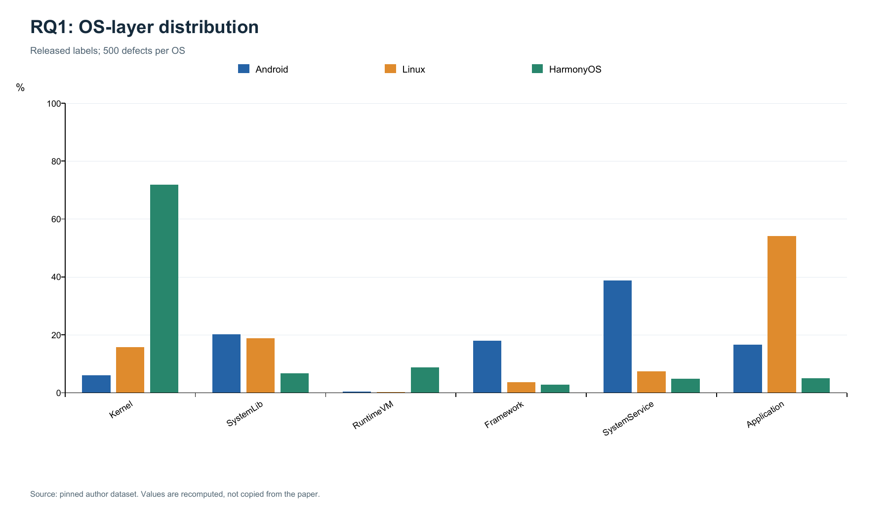

# OS Defects Replication: RQ1

复现 *Toward Understanding Operating System Defects*（arXiv:2608.20643v1）Table II 的完整五维统计，使用作者发布的 1,500 条标签，Android、Linux、HarmonyOS 各 500 条。

**本次周五检查：2026-11-06。** 从原来的系统层次 18 项扩展为五个维度的 **114 项对比**，并修复首次下载的校验问题。本次范围为 RQ1 / Table II；RQ2、RQ3 和修复规模 Figures 2/3 留待后续。

- [本周进展与结果说明](docs/weekly/2026-11-06.md)
- [114 项逐格对比](results/rq1/tables/table_ii.csv)
- [三次运行统计](results/rq1/tables/repeated_run_statistics.csv)
- [汇总](results/rq1/stage_summary.json)、[环境](results/rq1/environment.json)、[输入来源](results/rq1/source_provenance.json)
- [隔离验证：首次下载、离线缓存、原有入口与测试](results/rq1/verification.json)

## 结果

| 维度 | 类别数 | 对比项数 | 匹配项数 |
|---|---:|---:|---:|
| 系统层次 OS Layer | 6 | 18 | 18 |
| 受影响功能 Affected Function | 8 | 24 | 24 |
| 触发场景 Trigger Scenario | 7 | 21 | 21 |
| 严重性 Severity | 5 | 15 | 15 |
| 修复代码元素 Code Level | 12 | 36 | 36 |
| 合计 | 38 | 114 | **114** |

最大绝对差为 **0.00 个百分点**，三次计算的语义摘要一致。CSV 保留论文值、计算值、差值、match/mismatch 状态及来源。前四维为单标签；代码元素为多标签，各类别均以缺陷数 500 为分母，比例合计可以超过 100%。



其他图：[功能](results/rq1/figures/rq1_affected_function.png)、[触发场景](results/rq1/figures/rq1_trigger_scenario.png)、[严重性](results/rq1/figures/rq1_severity.png)、[代码元素](results/rq1/figures/rq1_code_level.png)。

## 运行

本次验证使用 Windows、Python 3.11.9、ReportLab 5.1.0、Pillow 12.3.0。绘图需要 Poppler 的 `pdftoppm` 在 PATH 中；实际版本见 environment.json。计数和测试只使用标准库，`--no-plots` 可跳过绘图依赖。

在仓库根目录执行，无需创建虚拟环境：

```powershell
# 仅在缺少绘图依赖时安装；Poppler 需单独安装并加入 PATH。
py -3.11 -m pip install -r requirements.txt

# 首次运行：下载固定输入、严格校验、计算三次并生成五张图。
py -3.11 scripts/run_stage.py --analysis rq1 --runs 3

# 离线复核另存结果，保留已提交的记录。
py -3.11 scripts/run_stage.py --analysis rq1 --runs 3 --offline --output-dir work/offline_check

# 无绘图依赖时，仍可完成全部数值计算。
py -3.11 scripts/run_stage.py --analysis rq1 --runs 3 --no-plots --output-dir work/counts_only

# 离线单元测试；第二条另需联网并已完成一次完整 RQ1 运行。
py -3.11 -m unittest discover -s tests -v
py -3.11 scripts/verify_reproduction.py
```

macOS/Linux 可将 `py -3.11` 替换为 `python3.11`，通过系统包管理器安装 Poppler。首次下载需要网络；没有缓存时 `--offline` 明确失败。旧的 `scripts/setup_venv.sh` 是历史可选辅助脚本，本次不使用。

旧入口 `--stage 1`（或不指定范围）继续计算系统层次 18 项，默认输出到 `results/weekend_01/`；`--all` 是该单一编号阶段的兼容入口。新增 `--analysis rq1` 输出到 `results/rq1/`。二者不可混用，`--runs` 至少为 3。后续未实现的分析不会出现在参数选项中。

## 输入与校验修复

固定来源：[作者数据](https://raw.githubusercontent.com/zuohongyao/zuohongyao.github.io/832d536f5d381d428a887e59ceeacc90a40e3b7e/index.html)。

- Commit：`832d536f5d381d428a887e59ceeacc90a40e3b7e`。
- CRLF/CR 统一为 LF 后：766,561 字节。
- SHA-256：`3794ff8c39e975ff457f264cb863f6e191297614dc0273f04c09ac654962eed5`。

旧摘要对应额外补一个末尾换行的文件；本次修正为真实固定文件的摘要，继续严格校验。若旧缓存校验失败，先保留备份，再下载固定文件到新的缓存位置，或移走旧缓存后重新运行。不要跳过校验，也不要用编辑器改变原始字节来凑摘要。

`data/` 下的原始缓存、派生数据和人工审查表均不提交 Git。数据异常保留在[审计文件](results/rq1/data_validation.json)中，不为匹配论文静默修正。

## 文件与范围

- `src/osdefects/`：读取、校验、计数、绘图和日志。
- `reference/paper_baselines.json`：单独从论文转录的基准，与计算结果分开。
- `tests/`：摘要、类别、记录、多标签分母、参考表结构和 CLI 回归测试。
- `results/rq1/`：本次证据。原 `results/weekend_01/` 保留历史结果，其旧摘要和环境不代表本次运行。
- `docs/weekly/`：每次检查的阶段报告。

结论是**作者发布标签的 Table II 统计得到复算验证**。重复执行不能证明标签正确或样本具有代表性。Linux 是 Launchpad/Ubuntu 生态样本，不能视为纯内核缺陷；不同来源的比例不能直接用于系统质量排名。人工复核尚未完成，生成审查模板不等于完成标注。

## 来源与贡献

[论文原文](https://arxiv.org/html/2608.20643v1)、[Table II](https://arxiv.org/html/2608.20643v1#S4.T2)、[作者数据固定版本](https://github.com/zuohongyao/zuohongyao.github.io/tree/832d536f5d381d428a887e59ceeacc90a40e3b7e)。

源数据及标签来自作者，本仓库实现重新计算和对比。上游授权遵循原作者声明，本项目未给上游材料另行指定许可证。Codex 协助代码、计算、基准核对和文档；自动核验不代表第二位学生的操作或人工重新标注，个人贡献应据实填写。
