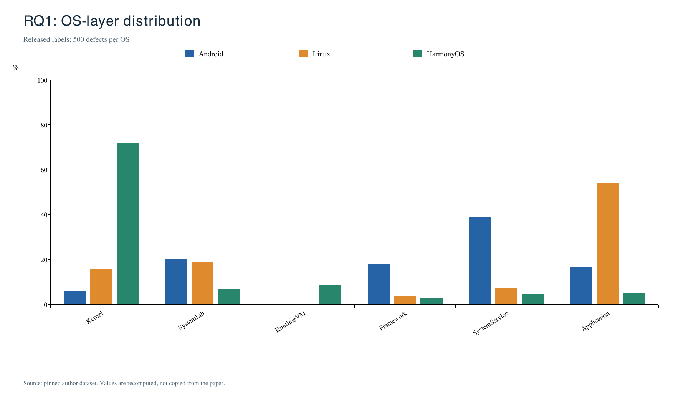

# OS Defects Replication: Phase 1

Reproduction of the **OS Layer block of Table II** in Hongyao Zuo, Jiali Li and Jiajun Jiang, *Toward Understanding Operating System Defects*, arXiv:2608.20643v1.

## Objective and method

Recompute six OS-layer categories from the authors' released labels for 1,500 defects: 500 each for Android, Linux and HarmonyOS. Each defect has exactly one OS-layer label. Percentage = category count / 500 x 100.

The pipeline fixes the input revision and checksum, extracts JSON arrays without executing JavaScript, validates record counts and unique IDs, normalizes category labels, computes the distributions and compares all 18 cells with the paper. Source anomalies are retained and disclosed in the run logs rather than silently corrected.

## Results

Each cell reports count / percentage; percentages also equal the mean across three deterministic runs.

| OS layer | Android | Linux | HarmonyOS |
|---|---:|---:|---:|
| Kernel | 30 / 6.00% | 79 / 15.80% | 359 / 71.80% |
| SystemLib | 101 / 20.20% | 94 / 18.80% | 34 / 6.80% |
| RuntimeVM | 2 / 0.40% | 1 / 0.20% | 44 / 8.80% |
| Framework | 90 / 18.00% | 18 / 3.60% | 14 / 2.80% |
| SystemService | 194 / 38.80% | 37 / 7.40% | 24 / 4.80% |
| Application | 83 / 16.60% | 271 / 54.20% | 25 / 5.00% |
| Total | 500 / 100.00% | 500 / 100.00% | 500 / 100.00% |

**18/18 cells match the paper; maximum absolute gap = 0.00 percentage points.** All three runs give identical numerical results and semantic hashes; the sample standard deviation of each repeated percentage is 0.00.

Android is dominated by SystemService (38.80%), Linux by Application (54.20%) and HarmonyOS by Kernel (71.80%).



- [Paper vs. Ours: all 18 cells](results/weekend_01/tables/table_ii.csv)
- [Three-run means and sample standard deviations](results/weekend_01/tables/repeated_run_statistics.csv)
- [Environment and code/input-reference hashes](results/weekend_01/environment.json)
- [Input provenance](results/weekend_01/source_provenance.json)
- Individual run outputs and logs: `results/weekend_01/runs/run_01/`, `run_02/`, `run_03/`.

## Reproduce

Tested with Python 3.12.14, ReportLab 4.4.9, Pillow 13.0.0 and Poppler/pdftoppm 26.04.0. Exact hardware, OS and kernel are recorded in environment.json. The core counting code uses the Python standard library; additional dependencies render the figure.

```sh
# macOS; on Linux install poppler-utils with the system package manager.
brew install poppler
sh scripts/setup_venv.sh

# First run after cloning: download and checksum-validate the pinned input.
.venv/bin/python scripts/run_stage.py --stage 1 --runs 3

# After a verified source cache exists:
.venv/bin/python scripts/run_stage.py --stage 1 --runs 3 --offline
```

The pipeline creates its local `data/` directories automatically. The raw input, derived datasets and optional review sheet are ignored by Git. First-run input acquisition requires network access. If blocked, save the fixed source below as `data/raw/index.html` and rerun with `--offline`; its checksum must match. Runtime is usually seconds to under a minute with installed dependencies; actual calculation times are saved in each run log, not compared with paper performance.

Input source: https://raw.githubusercontent.com/zuohongyao/zuohongyao.github.io/832d536f5d381d428a887e59ceeacc90a40e3b7e/index.html

Source revision: `832d536f5d381d428a887e59ceeacc90a40e3b7e`.

SHA-256 after CRLF/CR-to-LF normalization: `c617aa2478fea265b61c6b18ac158234ad1f2f4c4b3d0c8abbb7760f75e26a56`.

## Files

- `src/`: data extraction, validation, counts, plotting and run logging.
- `scripts/`: environment setup and project-relative run entry point.
- `reference/`: the paper's OS-layer reference values, separate from computed results.
- `results/weekend_01/`: comparison CSVs, figure, environment, provenance and all three real run logs.
- `requirements.txt`, `Makefile`, `.gitignore`: dependencies, run target and local-cache exclusions.
- `SNAPSHOT.json`: restricts this snapshot to phase 1; keep it with the runner.

## Interpretation and limitations

**Verdict: the released-label OS-layer statistics are reproduced.** This does not independently validate original collection, filtering or manual labeling. A zero repeated-run SD indicates stable deterministic execution, not annotation accuracy or sample representativeness. Linux is the sampled Launchpad/Ubuntu ecosystem, not exclusively kernel defects. This milestone makes no claim to reproduce other dimensions, causal explanations or the full paper. Human reannotation remains pending.

## Sources, attribution and AI assistance

- [Paper: arXiv:2608.20643v1](https://arxiv.org/abs/2608.20643v1)
- [Author data at the fixed source revision](https://github.com/zuohongyao/zuohongyao.github.io/tree/832d536f5d381d428a887e59ceeacc90a40e3b7e)

The author dashboard supplies the curated labels; the statistical pipeline is newly implemented. No upstream license statement was found at inspection; this project does not assign a license to upstream material. ReportLab, Pillow and Poppler retain their own upstream licenses.

Codex assisted in preparing the code, calculation and documentation. Recorded executions were performed during preparation. This is a merged technical result, not certification of individual students' contributions or completed human labeling. Contribution and AI statements in the final course submission should reflect actual work.
